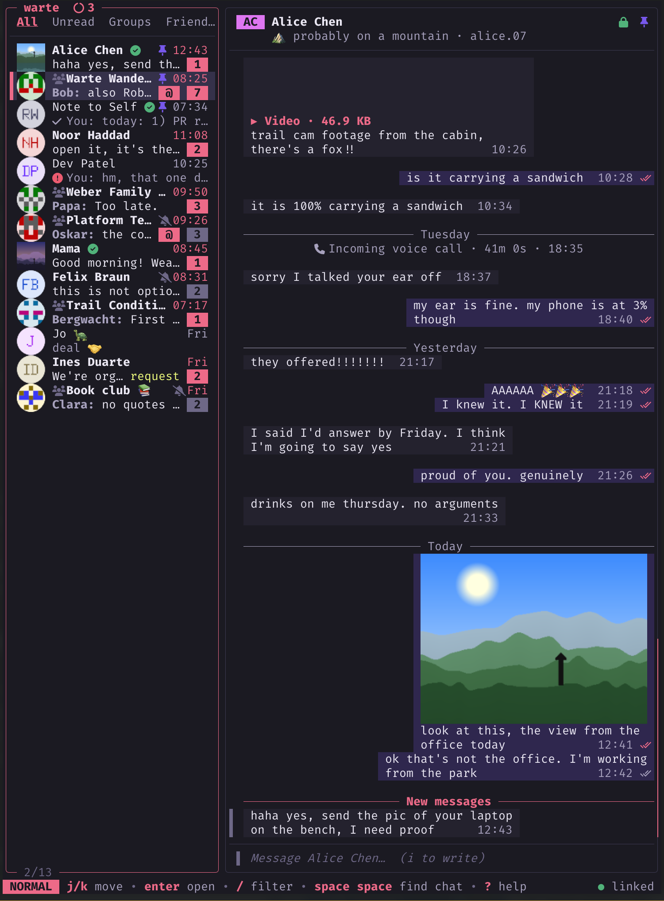

# warte

**~ a signal client for the terminal ~**


<sub>Diemardener Warte near Göttingen. Photo by
[Nemracc](https://commons.wikimedia.org/wiki/File:Watchtower_lookout_Diemardener_Warte,_district_G%C3%B6ttingen_01.jpg),
[CC BY-SA 4.0](https://creativecommons.org/licenses/by-sa/4.0/), via Wikimedia Commons.</sub>

> **Wạr·te** /ˈvaʁtə/ *noun, feminine* (die Warte, *pl.* die Warten)
>
> A medieval watchtower on a hilltop or ridge, one of a chain within
> sight of each other. Watchmen passed warnings along the line by
> fire and smoke.

*warte* is a **Signal client for the terminal**. Its keybindings are loosely
vim-inspired. I always wanted to build something with the awesome stuff by
[charm](https://github.com/charmbracelet) -
so this project uses Bubble Tea, Lip Gloss, Bubbles, Huh and Glamour.

*warte* runs as a **linked device** of the Signal account on your phone, the
same way Signal Desktop does. It uses libsignal
through [signalmeow](https://github.com/mautrix/signal), the Go Signal client
from mautrix-signal.

<p align="center">
  
</p>

## features

it can do everything I need day to day: messaging, chats, images,
pinning/unpinning, groups, hyperlinks (clickable!), notifications...

Anything missing that you need? Open an issue!

It has themes: charm, Catppuccin, Tokyo Night, Gruvbox, Rosé Pine,
Nord, mono, and auto to follow the terminal's background)

## requirements

for compiling:

- **Go 1.26** and a C compiler (cgo).
- **Rust** (`cargo`) to build libsignal once. `make libsignal` builds the exact
  libsignal version that the bundled signalmeow expects into
  `lib/libsignal_ffi.a`. Every warte binary links it, including the demo.
- for inline images: a terminal with the kitty graphics protocol (kitty,
  Ghostty, WezTerm), iTerm2 inline images (iTerm2, WezTerm) or sixel (foot,
  xterm, Windows Terminal, …). Other terminals get half-block images.

## Building

```sh
make            # builds lib/libsignal_ffi.a (first time only), then ./warte
make demo       # runs warte with a built-in demo account; no Signal connection
make test       # go test ./... (with the sqlite_fts5 build tag)
make install    # installs warte to /usr/local/bin (PREFIX=~/.local for ~/.local/bin)
```

Building by hand needs the `sqlite_fts5` build tag:

```sh
go build -tags sqlite_fts5 -o warte ./cmd/warte
```

## First run and linking

```sh
warte
```

If no account is linked yet, warte shows a QR code. On your phone open
Signal, go to **Settings › Linked devices › Link new device** and scan it.
The code refreshes every 45 seconds. After the scan warte saves the keys and
starts, and your phone sends recent message history, which warte imports in
the background.

The first run creates a random key for the local database and stores it in
the OS keychain (macOS Keychain, or the Secret Service on Linux). Without a
keychain warte asks for a passphrase on the terminal instead, before the
interface starts; there is no way to recover data if you forget it.

| Command | What it does |
| --- | --- |
| `warte` / `warte run` | Start the client (links first if needed) |
| `warte link` | Only link this device (refuses if already linked) |
| `warte unlink [--yes]` | Unlink this device from your account, then offer to delete the local data (database, attachments, keychain entry). `--yes` skips both questions |
| `warte export <path>` | Write an encrypted export of the local data to `path` |
| `warte --demo` | Try warte with a demo account (`warte link --demo` shows the link screen with a simulated phone) |
| `warte help` | All flags |

Only one warte process can use a data directory at a time (a lock file in
the data directory enforces this).

## keyboard

These are the defaults (from `internal/tui/keymap/defaults.go`). The leader
key is the space bar. Press `?` in warte for the keys of the current view.

**Moving around**

| Keys | Action |
| --- | --- |
| `j` `k` / `h` `l` | Move down / up / left / right |
| `gg` `G` | Top / bottom (with a count: item N) |
| `Ctrl-d` `Ctrl-u`, `Ctrl-f` `Ctrl-b` | Half page, page down / up |
| `H` `L`, `Ctrl-w h` `Ctrl-w l`, `Tab` | Focus left / right / next pane |
| `<leader><leader>` | Find a chat (fuzzy) |
| `]u` `[u` | Next / previous unread chat |
| `gt` `gT` | Next / previous chat folder |
| `Ctrl-o` `Ctrl-i` | Jump back / forward |
| `<leader>i` | Toggle the sidebar |
| `gi` `gm` `gp` | Chat settings, media gallery, pinned messages |

**Chats**

| Keys | Action |
| --- | --- |
| `Enter` | Open chat |
| `i` `a` `o` | Open chat and write |
| `/` | Filter the chat list |
| `za` `zm` `zp` `zu` | Archive, mute, pin, toggle unread |
| `A` | Show archived chats |
| `dd` | Delete chat |
| `<leader>n` `<leader>g` | New chat, new group |

**Messages** (in a conversation)

| Keys | Action |
| --- | --- |
| `i` `a` `I` | Write a message |
| `r` | Reply (quote) |
| `R` or `+` | React |
| `e` | Edit your message |
| `dd` / `dD` | Delete for me (synced to your phone; others still see it) / for everyone |
| `yy` / `yl` | Copy text / copy link |
| `f` | Forward |
| `Enter` | Open or expand (image viewer, link preview, …) |
| `o` / `gx` | Open attachment externally / open URL |
| `p` | Pin or unpin |
| `gq` | Jump to the quoted message |
| `K` / `gr` | Message details / reactions |
| `s` | Reveal spoiler |
| `v` `V` | Select messages (then `y` copy, `d` delete, `f` forward) |
| `/`, `n` `N` | Search in chat, next / previous hit (`:search from:bob has:image` takes filters) |
| `.` | Repeat the last change |

**Writing** (insert mode)

| Keys | Action |
| --- | --- |
| `Enter` / `Alt-Enter` | Send / new line (swap with `send_on_enter = false`) |
| `Esc` | Back to normal mode |
| `←` at the start of the text | Back to the chat list (draft kept) |
| `↑` on the first line | Select messages, newest first (draft kept); `↓` past the newest comes back |
| `Ctrl-e` | Compose in `$EDITOR` |
| `Ctrl-a` / `Ctrl-v` | Attach a file / paste text or an image (images are read from the system clipboard; in Ghostty use `Ctrl-v`, since `Cmd-v` only pastes text) |
| `Ctrl-g` / `Ctrl-s` | Emoji picker / sticker picker |
| `Tab` | Complete `@mentions` and `:emoji:` |
| `Ctrl-r` | Cancel the reply |

**Everywhere else**

| Keys | Action |
| --- | --- |
| `?` | Help |
| `:` | Command line (`:new alice`, `:mute 8h`, `:disappear 1w`, `:theme nord`, `:set mouse`, `:q`, …) |
| `<leader>/` | Search all chats |
| `<leader>l` or `:lock` | Lock the screen |
| `<leader>s` `<leader>c` | Stories, calls |
| `<leader>,` `<leader>t` | Settings, theme picker |
| `q` / `Esc` | Back, close |
| `ZZ` or `:q` | Quit |

## configuration

warte reads `config.toml` from:

- `$WARTE_CONFIG`, if set;
- otherwise `$XDG_CONFIG_HOME/warte/config.toml`;
- otherwise `~/.config/warte/config.toml` (on macOS
  `~/Library/Application Support/warte/config.toml`, unless `~/.config/warte`
  exists).

[`internal/config/sample.toml`](internal/config/sample.toml) lists every
option with its default (theme, layout, images, notifications, editor,
device name, log level, key remaps under `[keys.normal]` and so on). Changes
made in warte (`:theme`, `:set`, settings) are saved with `:w`.

Other locations:

| What | Linux | macOS |
| --- | --- | --- |
| Data (database, attachments) | `$XDG_DATA_HOME/warte` or `~/.local/share/warte` | `~/Library/Application Support/warte` |
| Log | `$XDG_STATE_HOME/warte/warte.log` or `~/.local/state/warte/warte.log` | `~/Library/Logs/warte/warte.log` |

Environment variables: `WARTE_CONFIG` (config file), `WARTE_THEME` and
`WARTE_IMAGES` (override the config), `NO_COLOR`, and `WARTE_PASSPHRASE` (the
data passphrase when there is no keychain, for scripts; warte warns when it
is used). For testing, `WARTE_KEYRING=file` skips the keychain and always
uses a passphrase, and `WARTE_KEYRING=mock` uses an in-memory keychain that
is forgotten on exit (the data cannot be opened again; use it with a
throwaway `XDG_DATA_HOME`).

## limitations

- no voice or video calls
- linked device only. *warte* cannot register a new Signal account.
- chat folders made on your phone show up as tabs, but warte can't create
- you can't set or change your username, and voice notes can't be recorded

## license

*warte* is free software under the GNU Affero General Public License v3.0; see
[LICENSE](LICENSE). It includes a modified copy of mautrix-signal
(`fork/mautrix-signal`, also AGPL-3.0; changes are listed in
[`fork/CHANGES.md`](fork/CHANGES.md)).

## alternatives

if you don't like *warte*, try these wonderful alternatives:

- [gurk](https://github.com/boxdot/gurk-rs)
- [siggy](https://siggy.chat/)

## credits

this humble software is standing on the shoulders of giants:

- [mautrix-signal / signalmeow](https://github.com/mautrix/signal) by Tulir
  Asokan and contributors: the Go Signal client warte is built on.
- [libsignal](https://github.com/signalapp/libsignal) by Signal Messenger:
  the protocol and cryptography.
- [Signal Desktop](https://github.com/signalapp/Signal-Desktop): the reference
  for how features behave.
- [Charm](https://charm.sh): Bubble Tea, Lip Gloss, Bubbles, Huh, Harmonica
  and Log.
- [SQLCipher](https://www.zetetic.net/sqlcipher/) via go-sqlcipher.

*warte* is not affiliated with Signal Messenger or the Signal Technology
Foundation.
